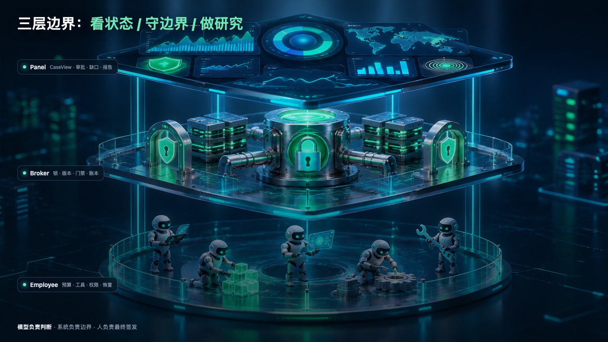

# 天枢 · 边界智能投研 Agent

把 AI 投研从“聊天记录”，变成可签发、可复现的报告流水线。

单用户本地运行 · 证据可追溯 · 失败可恢复 · 报告可 verify

> 不是又一个“帮你写研报”的聊天框。  
> 它把研究拆成计划、任务、证据、复核、签发、校验，  
> 让模型在边界内做判断，让系统在边界外做交付。

*视觉示意：左侧是不可验证的 AI 研报，右侧是可签发、可追溯、可恢复的投研交付链。*

## 它解决什么问题

普通 AI 研报工具通常停在三个地方：

~~~text
生成一段看起来专业的文字
给出几个可以点开的链接
模型说“完成了”，但没人能验收
~~~

天枢把最后一段补上：

~~~text
Case → Plan → WorkItem → Employee Loop
     → Gate → Evidence → Report → Sign → Verify
~~~

每一步都有状态、有产物、有责任人、有恢复路径。

## 三个可验证的差异

### 1. 报告不是“生成”，是“签发”

最终报告有：

~~~text
manifest
signature
verify
~~~

签发后仍能证明：

~~~text
报告用了哪份数据
数据是什么时候的
证据有没有被替换
~~~

不是“模型写完就结束”。

### 2. 证据不是链接，是可追溯快照

每条证据有：

~~~text
S#
snapshot
sha256
dataAsOf
sourceType
~~~

来源可以是：

~~~text
URL
用户上传文件
数据 connector
由其他证据衍生
~~~

报告里的数字可以回到证据，而不是回到一句“据公开资料”。

*视觉示意：报告数字 → S# → 快照 → sha256 → manifest → verify。*

### 3. 失败可恢复，不是卡住重开

长任务常见的问题不是“不会做”，而是：

~~~text
跑一半超时
上下文丢失
锁定冲突
模型调用失败
~~~

天枢有：

~~~text
Lead 租约
心跳
resume
takeover
failureKind
阻塞 need
~~~

能继续的继续，不能继续的明确告诉用户卡在哪。

## 一份报告是怎么被签发的

~~~text
研究底稿
  → 证据引用校验
  → 数字与口径检查
  → 审计复核
  → 法务复核
  → 数据新鲜度 / license
  → 人工签发
  → manifest + signature
  → verify
~~~

只有前面全部通过，签发按钮才可用。

## 真实产物长什么样

报告 verify 的检查项：

~~~text
PASS report_exists
PASS manifest_exists
PASS signature_exists
PASS manifest_report_sha
PASS signature_sha
PASS manifest_version
PASS evidence_file
PASS evidence_ids
PASS evidence_snapshots
PASS data_as_of
~~~

这不是“AI 说完成”，而是系统能重新验一遍。

## 60 秒看到 Panel

只看界面，只需要 Node.js 18+：

~~~bash
git clone https://github.com/Hugoiku/TeamPanel.git
cd TeamPanel
node scripts/init-worktree.js --demo
./start.sh
~~~

打开：

~~~text
http://127.0.0.1:7801/live
~~~

先说清楚：

~~~text
仓库不包含作者本地的 vault/ 研究数据
--demo 只创建一个空演示 case
完整研究需要 dsh + 一个可用模型
~~~

### 真正开始跑研究

在最小前提上增加：

~~~text
DeepSeek Harness（dsh CLI）
至少一个 dsh 可调用的模型
可访问模型 API 的网络
~~~

把 Panel 的**初始默认模型**设成 dsh 当前正在用的模型，保证第一次派活能跑通。  
跑通之后，Panel 的模型配置是独立的：可以全员换、给单个员工换、加多个 provider。

详细步骤见 [docs/QUICKSTART.md](docs/QUICKSTART.md)。

### 让 Agent 自动部署

如果你希望 DeepSeek Harness Agent 自己完成 clone、初始化、配置和验收，可以直接使用：

[docs/AGENT-DEPLOY.md](docs/AGENT-DEPLOY.md)

里面包含可复制的部署提示词和正式使用验收标准。

## 和单 Agent / Deep Research 的区别

| 能力 | 普通对话 | 通用 Deep Research | 天枢 |
|---|---|---|---|
| 生成研究报告草稿 | √ | √ | √ |
| 多角色任务拆分 | — | △ | √ |
| 计划审批 | — | — | √ |
| 证据快照与 sha256 | — | △ | √ |
| 数字与引用门禁 | — | — | √ |
| 失败恢复 / 接管 | — | △ | √ |
| 报告签发与 verify | — | — | √ |
| 单用户本地运行 | — | — | √ |

> √ 原生支持；△ 部分支持；— 不具备。

## 架构

*视觉示意：上面看状态，中间守边界，下面做研究。*

运行时由三部分组成：

~~~text
Panel     看状态、做审批、处理缺口
Broker    锁 / 版本 CAS / 门禁 / 复核 / 账本
Employee  在预算和权限内执行 WorkItem
~~~

模型负责判断，系统负责边界，人负责最终签发。

## 适合谁

- 独立分析师、研究员；
- 小团队内部研究；
- 需要审计、复现、交接的投研流程；
- 希望数据留在本机、自己控制模型和数据源的人；
- 做 A 股 / 中国宏观，需要中文官方来源的人。

## 不适合谁

- 需要实时行情、交易执行的交易台；
- 需要全市场覆盖、券商研报库、共识预期的机构研究部；
- 需要多租户、RBAC、SSO 的企业级部署；
- 只想“问一句就出一篇研报”的轻量用户。

## 当前边界

~~~text
单机、单用户
没有多租户 / RBAC / 高可用
知识层是只读视图，不是完整知识池
事件驱动控制面、section 级缓存未做
文件证据 hash 目前读取时计算，尚未全部持久化
~~~

当前定位是：

~~~text
单用户投研工作台：可用
单用户生产 beta：是
完整生产级：仍差最后一段闭环
~~~

## 文档

- [docs/QUICKSTART.md](docs/QUICKSTART.md)：启动、模型、凭据、跨机器访问
- [docs/AGENT-DEPLOY.md](docs/AGENT-DEPLOY.md)：交给 DeepSeek Harness Agent 自动部署
- [docs/DESIGN.md](docs/DESIGN.md)：整体设计
- [docs/AGENT-LOOP.md](docs/AGENT-LOOP.md)：双层有界 Agent / WorkItem
- [docs/DATA-COLLECTION.md](docs/DATA-COLLECTION.md)：数据采集与 DataGateway
- [docs/DATA-TASK.md](docs/DATA-TASK.md)：缺口补齐

## License

[Apache-2.0](LICENSE)
