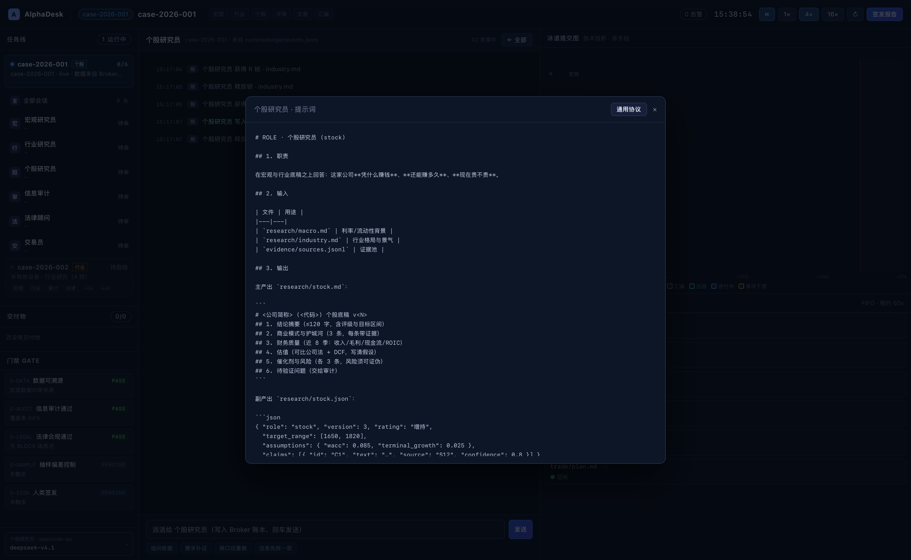
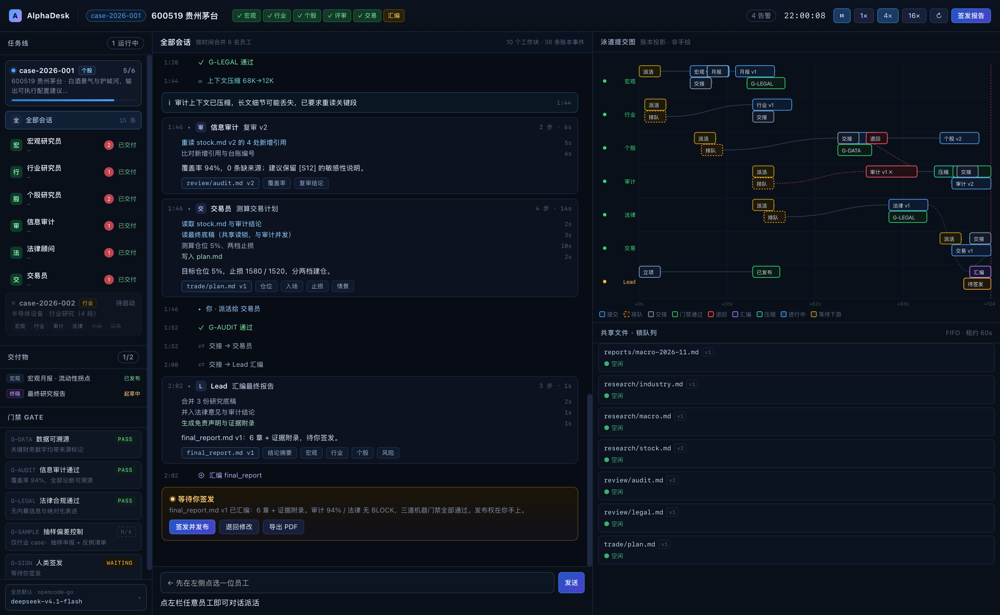
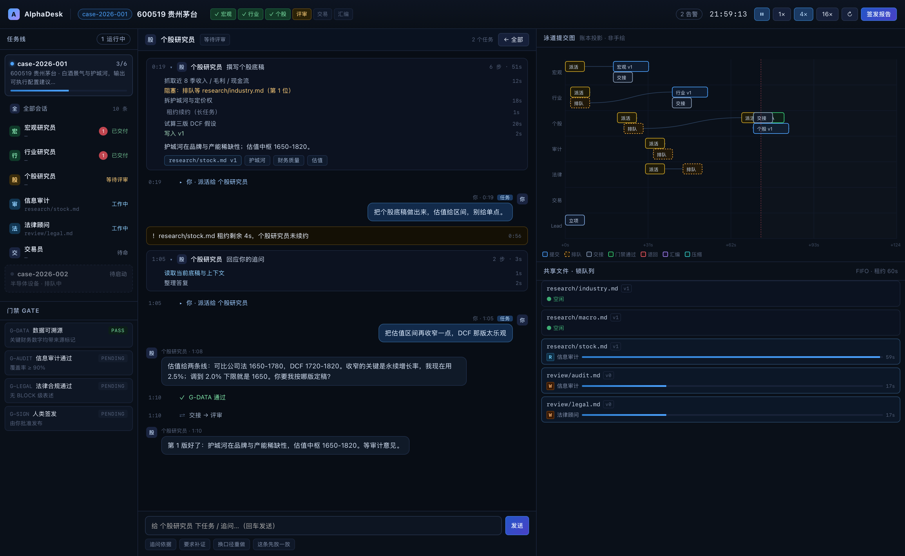
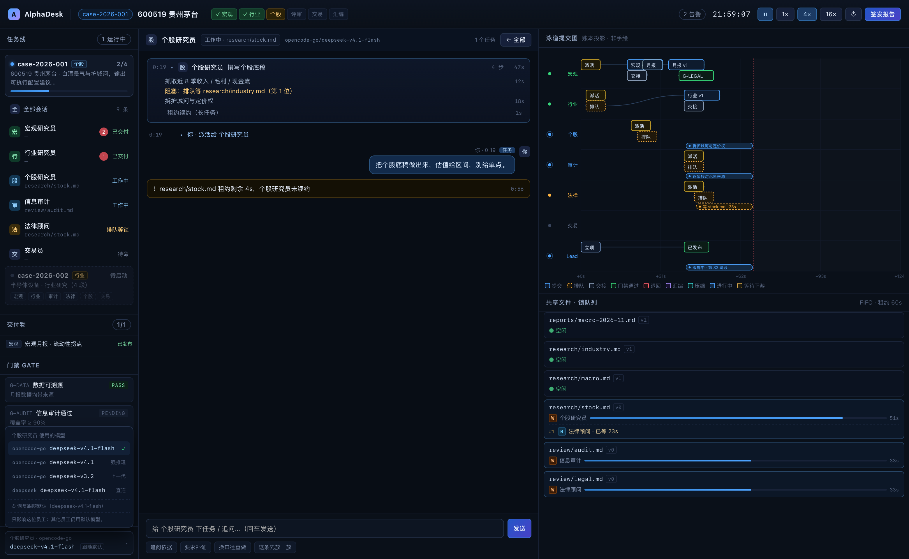
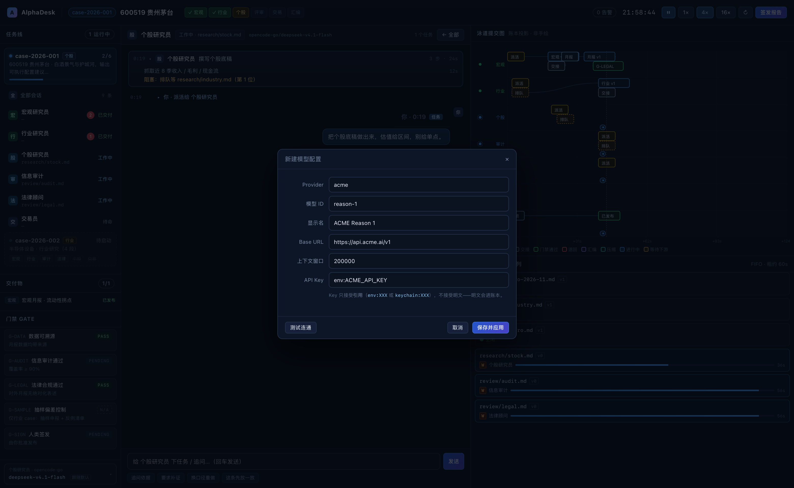
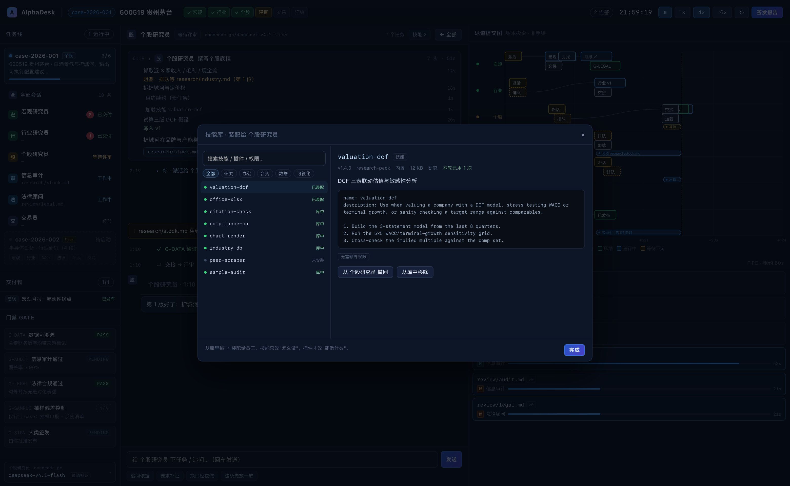
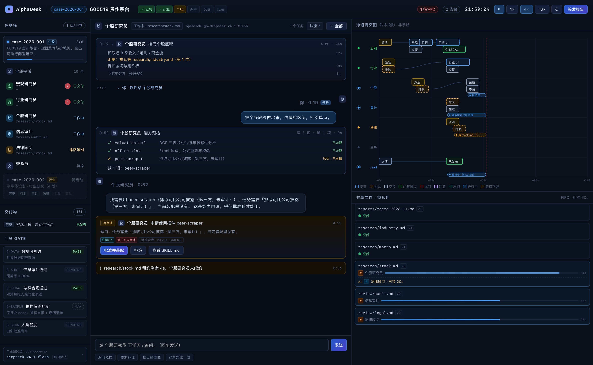
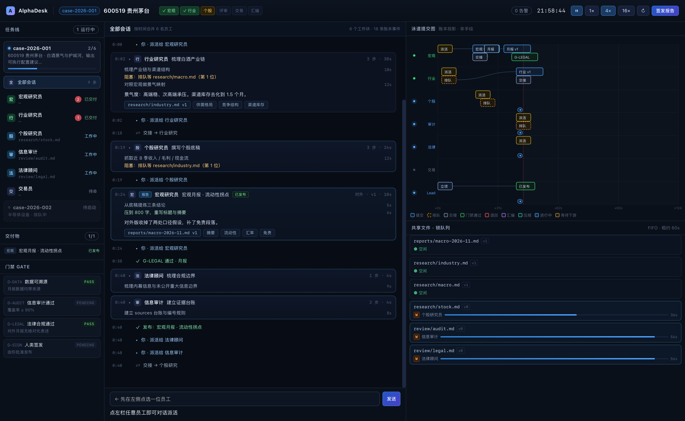
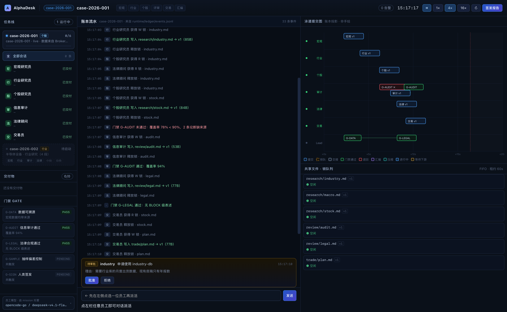

# AlphaDesk · Agent 投研流水线 — 设计框架 v0.13

> 状态：**待评审**（本文档只做设计，不含实现）
> 修订：v0.13 能力预检（开工前算出缺什么，§3.6）。v0.12 能力申请必须经你批准（员工只能申请不能安装，§3.6）。v0.11 技能库与装配分成两层（库可浏览、装了才能装配，§3.6）。v0.10 技能/插件按员工装配（§3.6，参照 DSH 的 SKILL.md + 懒加载设计）。v0.9 支持新建第三方模型配置（目录 + 凭据引用 + 连通测试，§3.1）。v0.8 每个员工默认可配置模型（opencode-go / deepseek-v4.1-flash，§3.1）。v0.7 新增行业 case 强制门禁 G-SAMPLE（抽样申报 + 反例清单，§3.5）。v0.6 case 类型决定角色与 DAG，行业研究默认不启用个股/交易（§3.5）。v0.5 把“报告”提成一等交付物，宏观/行业/个股都能出独立报告（§3.4）。v0.4.1 泳道图改为“离散事件 + 连续状态”两层（§6.5）。v0.4 增加“员工会话 + 派活”（§6.6）。v0.3 落地双轨制 + 三栏面板（左任务线 / 中执行轨迹 / 右泳道图），并补齐 handoff / 压缩 / 退回事件。v0.2 吸收了两次外部参考核查（[REFERENCE-NOTES](REFERENCE-NOTES.md)、[PANEL-BORROW](PANEL-BORROW.md)），改动集中在 §4.1 双轨制、§5 事件表、§6.5 主视图、§11 决策项。
> 目标产物：一个多角色 Agent 团队，围绕某只股票 / 某个行业，协作产出**可审计的研究报告**；
> 你在一个**实时面板**上监督他们，并对最终报告签字放行。

---

## 0. 一句话方案

把"团队协作"拆成三件互相独立、都可单独验证的事：

| 层 | 解决什么 | 关键设计 |
|---|---|---|
| **编排层 (Orchestration)** | 谁在什么时候做什么 | 角色 + 阶段 DAG + 门禁 (gate) |
| **协作层 (Collaboration)** | 共享文件的读写不打架 | **Broker 排队锁**：唯一写入口 + 严格 FIFO + 租约 |
| **观察层 (Observability)** | 你怎么"看见"他们在干活 | **事件账本 (event log)** + 只读投影面板 |

核心判断：**面板不是"日志查看器"，而是账本的一个纯投影。**
所有状态都能由事件重放算出来，所以面板永远不会和真实状态不一致，也不需要和业务代码共享内存。

---

## 1. 设计原则（也是评审时可以拿来挑刺的靶子）

1. **单一写入口**：共享文件只有 Broker 能落盘。Agent 拿不到直接写权限 → 排队机制是**强制的**，不是"请大家自觉"。
2. **事件优先**：任何状态变化先写账本，再改状态。面板只读账本。
3. **一文件一队**：排队粒度是"文件"，不是"人"，也不是"全局"。宏观和行业可以同时干活，只在抢同一份文件时排队。
4. **悲观加锁 + 乐观校验**：先拿锁（悲观），写入时带 `expected_version` 做 CAS（乐观）。两道防线，宁可让 Agent 重试，也不要静默覆盖。
5. **一切可归因**：每条写入都能回答"谁、什么时候、基于哪个版本、改了什么、依据什么锁"。
6. **人始终在环**：你是 supervisor，拥有强制释放锁、驳回门禁、暂停员工、最终签发的权力。
7. **不引入运行时依赖**：Broker + 面板 = 一个 Node 进程，零 npm 依赖（JSONL + 原子改名）。降低"跑不起来"的风险。

---

## 2. 总体架构

```
                        ┌──────────────────────────────────────────┐
                        │            你 (Supervisor)                │
                        │   看板 / 强制释放 / 门禁批准 / 签发报告      │
                        └───────────────┬──────────────────────────┘
                                        │ HTTP + SSE (只读投影)
┌───────────────────────────────────────▼──────────────────────────────────┐
│  AlphaDesk Broker  (单进程, node, 零依赖)                                  │
│                                                                          │
│   ┌──────────────┐  ┌───────────────┐  ┌──────────────┐  ┌────────────┐  │
│   │ 锁队列         │  │ 版本仓库       │  │ 门禁引擎      │  │ 事件账本    │  │
│   │ FIFO + 租约    │  │ sha256 + CAS  │  │ gate rules   │  │ JSONL 追加  │  │
│   └──────┬───────┘  └───────┬───────┘  └──────┬───────┘  └─────┬──────┘  │
│          └──────────────────┴─────────────────┴────────────────┘         │
│                       唯一写入口 (vault 只对它可写)                        │
└───────────▲──────────────────────────────────────────────────────────────┘
            │ desk acquire / read / write / release  (HTTP, 带 request_id)
            │
  ┌─────────┴───────────────────────────────────────────────────────────┐
  │  6 名 Agent（DSH teammates，共享同一工作目录）                        │
  │  macro ─→ industry ─→ stock ─→ [legal ∥ audit] ─→ trader ─→ final   │
  └─────────────────────────────────────────────────────────────────────┘
            │ 只读
            ▼
      vault/  权威文件区 ； runtime/  账本+锁状态 ； history/  历史版本
```

**为什么不是"纯文件锁"（mkdir / flock / 锁文件）？**

| 方案 | FIFO 公平 | 可观测 | 租约/防死锁 | 越权检测 | 结论 |
|---|---|---|---|---|---|
| `mkdir` 原子占位 | ✗ 抢到算谁的 | 弱 | ✗ | ✗ | 只适合 demo |
| `flock` | ✗ 不保证顺序 | ✗ | 弱 | ✗ | 会饿死 Agent |
| 票据文件自排队 | 半（有竞态） | 中 | ✗ | ✗ | 实现脆弱 |
| **Broker 集中式** | ✓ 内存队列天然有序 | ✓ 状态即真相 | ✓ TTL 自动回收 | ✓ 唯一入口 | **选它** |

代价：多一个进程、Agent 必须走 CLI/HTTP。收益：排队、面板、审计三件事一次解决。**这个取舍是本方案最需要你确认的一点。**

---

## 3. 角色与工作流

### 3.1 角色配置

**基础配置（必选）**

| 角色 | id | 职责 | 主要产出 |
|---|---|---|---|
| 宏观研究员 | `macro` | 利率/政策/流动性/汇率周期判断 | `research/macro.md` |
| 行业研究员 | `industry` | 行业格局、供需、竞争、产业链 | `research/industry.md` |
| 个股研究员 | `stock` | 公司基本面、财务、估值、催化 | `research/stock.md` |

**高级配置（按需启用）**

| 角色 | id | 职责 | 主要产出 | 卡点 |
|---|---|---|---|---|
| 法律顾问 | `legal` | 合规审查：内幕信息、未公开重大信息、免责声明、表述风险 | `review/legal.md` | 驳回则报告不得发布 |
| 信息审计 | `audit` | 证据链核验：每个事实性结论必须有可追溯来源 | `review/audit.md` + `evidence/sources.jsonl` | 未通过则退回作者 |
| 交易员 | `trader` | 把结论翻译成可执行动作：仓位、入场、止损、情景 | `trade/plan.md` | 依赖审计通过 |

**模型配置**（v0.8）：每个员工默认使用 `opencode-go / deepseek-v4.1-flash`，可在面板左下角像 DSH 那样单独切换某位员工的模型，也可改全局默认。三条原则：

1. **模型是执行资源，不是身份。** 员工是谁由 ROLE.md 和任务决定，换模型不改变职责与权限——所以换模型不产生新版本、不影响门禁。
2. **默认必须显式写在 mission 里**（`mission.created.payload.models`），否则回放时无法还原"这条结论是哪个模型生成的"。
3. **监控意义**：换模型要记一条 `model.changed` 事件。某位员工上下文涨到 60K 还在涨，或者反复出错，你会想给他换更强的模型——这个动作必须留痕，否则后面没人说得清结论是怎么来的。

#### 新建模型配置（v0.9）

模型列表不能写死。分三层：

| 层 | 内容 | 存哪 |
|---|---|---|
| **目录 catalog** | 内置 4 条 + 自建条目 | `config/models.json`（Broker 加载，热更新） |
| **绑定 binding** | 全局默认 + 员工级覆盖 | mission 里 pin 一份快照 |
| **凭证 secret** | 只存**引用**，不存值 | `env:VAR` / `keychain:ITEM` |

自建条目字段：`provider` / `model_id` / `label` / `base_url` / `context_window` / `tools` / `vision` / `cost_in` / `cost_out` / `key_ref` / `builtin:false`。

**新建流程**（面板）：模型选择器底部 `＋ 新建模型配置` → 表单 → **测试连通** → 保存并应用。

三条硬规则：

1. **面板拒收明文 Key。** 只接受 `env:VAR` 或 `keychain:ITEM`。明文一旦进了表单，就有进账本、进前端源码、进截图的三种泄露路径——而账本是给审计看的。
2. **自建与内置同等地位，但标记 `builtin:false` 可删。** 内置不可删，避免把默认模型删没了导致全员无模型可用。
3. **目录变更也要留痕。** `model.added` / `model.removed` 进账本——"谁在什么时候加了一个模型"必须可查，因为模型决定结论口径。

**一个实现边界**：`测试连通` 必须由 **Broker 代理**发出，不能由浏览器直连第三方。否则 Key 会出现在前端进程里，面板就成了一条凭据泄露通道。原型里的"182ms 连通"是模拟值。

### 3.2 阶段 DAG

```
S0 立项  mission.md(case 名可中文；标的、期限、深度可留空，之后对话补)
   │
S1 ├─► macro   ──► research/macro.md ──┐
   │                                   ├──► S2 industry 读 macro 产出 industry.md
   │                                   │
S2 └───────────────────────────────────┘        (S1/S2 可并行, 抢同一文件时才排队)
   │
S3 stock  读 macro + industry  →  research/stock.md
   │
S4 并行评审:  ├─ legal  读 stock + 全部research → review/legal.md
              └─ audit  读全部 → 逐条打证据分 → review/audit.md
   │
   ├── gate: audit=PASS 且 legal=PASS  ──► 否则退回 S3 修订(计数+1, 上限3轮)
   │
S5 trader 读 stock + audit →  trade/plan.md
   │
S6 Lead 汇编 final_report.md  →  gate: 你签字 → 发布
```

**为什么这样切**：S1/S2 并行能演示"多人同时在线但互不阻塞"；S4 的 legal 与 audit **同时读**同一批文件，正好演示共享读锁（多人可同时读）；S3→S4 与 S5 之间是典型"上一处理人未完成，下一人排队"的场景。

**立项可以很轻**：`/api/case` 的 case 名允许中文（字母/数字/中文/. _ -，≤40 字），**标的不必在创建时确定**——个股、ETF、指数、行业都可以先留空，类型（`kind`）也可选填。留空时 mission.md 写 `标的: 待定（创建后通过对话补齐…）` / `任务: 待补充`，面板上显示「标的待定」。员工第一轮读到待定，必须先 `desk need --kind info` 问清标的与目标再动手，不允许自己替监督者选个股。

### 3.3 门禁 (gate) 规则

| gate | 触发点 | 通过条件 | 失败动作 |
|---|---|---|---|
| `G-DATA` | stock 提交后 | 关键财务数字均带 `[S#]` 来源标记 | 退回 stock 补引用 |
| `G-AUDIT` | audit 提交后 | 无 `unsupported` 级别论断 且 证据覆盖率 ≥ 90% | 退回至对应作者 |
| `G-LEGAL` | legal 提交后 | 无 `BLOCK` 级问题（内幕/未公开信息/绝对化表述） | 强制退回 |
| `G-SAMPLE` | 行业 case 启用个股抽样佐证时 | **抽样事前一申报** + 分层覆盖 + **反例清单** | 退回重抽（上限 2 轮） |
| `G-SIGN` | 汇编完成 | **你**点击批准 | 报告不发布 |

门禁不是"Agent 自己说通过"，而是 Broker 侧校验结构化结果（`review/*.json` 里的机器可读判定），面板只做展示。

---

### 3.4 交付物：底稿 ≠ 报告（v0.5）

原来模型里只有一份终稿，宏观和行业只产"底稿"喂下游——等于默认了他们不出报告。实际上这三类角色**偶尔都要出独立报告**（宏观月报、行业深度、个股点评）。所以把"报告"提成一等交付物：

| 形态 | 是什么 | 谁看 | 门禁 | 存放 |
|---|---|---|---|---|
| **研究底稿** study | 给下游同事用的中间产物，可粗糙 | 同事 | `G-DATA` | `vault/research/` |
| **内部报告** | 可独立阅读的成品 | 团队 + 你 | `G-DATA` + `G-AUDIT` | `vault/reports/` |
| **对外报告** | 可发布给客户/公众 | 客户 | 再 + `G-LEGAL` | `vault/reports/` + 发布记录 |
| **终稿** | 一个 case 的最终交付 | 你签发 | 全部 + `G-SIGN` | `vault/final_report.md` |

四条规则：

1. **一份文档，两种形态。** 报告不是另写一份，而是底稿"晋升"（promote）而来：补封面/摘要/受众/免责段落，压缩字数，然后过更严的门禁。避免同一个人维护两份会漂移的文本。
2. **报告是可选交付物。** 由你派活触发（任务带 `kind=report`），不做就不产。所以"出不出宏观月报"是**你的调度决定**，不是流水线的固定环节。
3. **门禁按报告类型配置。** 对外报告的 `G-LEGAL` 是硬门禁；内部报告只走 `G-DATA` + `G-AUDIT`，否则法律顾问会成为瓶颈。
4. **报告本身是审计对象。** 标题、受众、版本、作者、发布日期、引用来源、审阅人都要留痕；**发布是不可逆动作**——发布后要改必须出新版本，旧版本留在 `history/` 并标记"已撤回"。

这也是排版上把"交付物"放进左栏的原因：你要一眼看到**已经出了几份、哪几份已发布、哪几份还压着没发**。

---

### 3.5 case 类型决定角色与 DAG（v0.6）

**问题：只研究一个行业时，个股研究员会启用吗？**

按 v0.5 的固定 DAG —— 会。那是错的。角色不是常驻编制，是由 **case 类型**推导出来的。

#### 角色启用矩阵

| case 类型 | 宏观 | 行业 | 个股 | 审计 | 法律 | 交易 |
|---|---|---|---|---|---|---|
| **宏观专题** macro | ● | ○ 验证用 | ✗ | ● | ●（对外） | ✗ |
| **行业研究** industry | ● | ● | ○ 抽样佐证 | ● | ●（对外） | ○ 板块配置 |
| **个股研究** stock | ● | ● | ● | ● | ●（对外） | ● |
| **组合策略** portfolio | ● | ● | ✗ | ● | ○ | ● |

● 必选　○ 可选（派活时勾选）　✗ 不启用

#### 个股研究员在行业 case 里的三态

1. **缺席（默认）**——报告只到行业层面：景气、格局、供需、估值带，不给个股结论，也不给目标价。
2. **抽样佐证**——为了证明行业结论，选 2~3 家代表公司做案例，产出 `research/cases/<ticker>.md`。他只回答一个问题："这家公司能不能印证行业判断？"**不跑个股全套门禁，不给目标价，不进交易环节**。行业报告里"以 XX 公司为例"就是这种。
3. **升级成个股 case**——如果你要完整的个股结论（估值、目标价、风险、仓位），那是**另一个 case**，不是这个 case 的一个阶段。强行塞进行业 case，会让审计的证据要求和时长都失控。

#### DAG 是生成的，不是写死的

| case 类型 | 阶段链 | 段数 |
|---|---|---|
| 个股 stock | S1 宏观 → S2 行业 → S3 个股 → S4 评审 → S5 交易 → S6 汇编 | 6 |
| 行业 industry | S1 宏观 → S2 行业 →（○ 抽样佐证）→ S4 评审 → S6 汇编 | 4~5 |
| 宏观 macro | S1 宏观 → S4 评审 → S6 汇编 | 3 |
| 组合 portfolio | S1 → S2 → S4 → S5 配置 → S6 | 5 |

面板上的阶段进度条按**该 case 的段数**算，不是固定的 `x/6`。

#### 门禁也要裁剪

- 行业 case 没有"关键财务数字必带来源"的 `G-DATA`（那是个股口径），但要有**行业数据口径**：样本量、统计口径、时间窗。
- 内部行业底稿不需要 `G-LEGAL`；一旦写成对外报告，`G-LEGAL` 立刻变成硬门禁。
- `G-SIGN` 永远在：不管什么 case，发布权都在你手上。

#### 行业 case 的强制门禁：`G-SAMPLE`

行业研究最危险的不是"数据不准"，是**选择性举证**——挑三家支持结论的公司当案例，反例没人看。光靠 prompt 治不住，所以做成硬门禁。

| 要过 `G-SAMPLE`，必须同时满足 | 判定物 |
|---|---|
| ① **抽样方法事前申报**：分层维度（市值 / 份额 / 区域 / 商业模式）+ 每层样本数 + 抽样依据 | `reports/sampling.json` |
| ② **覆盖至少两个极端层**（最高 / 最低），或书面说明为什么不需要 | 同上 `coverage` 字段 |
| ③ **反例清单 ≥ 1 条**（与结论相反的案例），或写明"未找到反例"并给出检索边界 | `reports/counter-cases.md` |

三个设计要点：

1. **事前，不是事后。** 抽样声明必须先于任何案例撰写。这条不需要额外系统——账本里直接校验 `sampling.declared` 的 `seq` 早于第一条 `research/cases/` 的写入即可。事后补的抽样声明一律判无效。
2. **集合层面，逐条之外。** `G-AUDIT` 查"每条论断有没有来源"，`G-SAMPLE` 查"样本集本身有没有偏"。两者不互相替代。
3. **反例是必填项，不是加分项。** 没有反例的行业报告直接退回。允许写"未找到"，但必须给检索边界（查了哪些库、什么时间窗、什么关键词），否则等于没找。

失败动作：退回行业研究员重抽或补反例，上限 2 轮；第 2 次仍失败，直接上报给你，不再自动重试。

#### 工程上必须记住的一条

**角色启用是 mission 的一部分，要写进账本**（`mission.created.payload.roles`）。因为面板、DAG、门禁裁剪、派活时的可选列表全都要读它——不能让每个 Agent 自己判断"我该不该干活"。

面板上的表现（已实现）：
- 左栏 case 卡带类型 chip（宏观 / 行业 / 个股 / 组合）；
- **未启用的角色显示"未启用"（灰、不可派活），而不是"待命"**——否则你会以为他在摸鱼；
- 泳道图只画该 case 启用的车道；
- 给未启用角色派活时，提示"该角色未在本 case 启用，是否新开一个 case？"。

---

### 3.6 技能与插件：按员工装配（v0.10）

DSH 的做法我把 asar 扒开看了，三层结构值得直接照抄：

| 层 | DSH 怎么做 | 我们怎么用 |
|---|---|---|
| **包** | skill = 一个目录：`SKILL.md`（YAML frontmatter：`name` + `description`）+ assets，随 npm 包分发（如 `@deepseek-ai/dsh-skill-office/assets/office-xlsx`） | 我们的从 `skills/<id>/SKILL.md` 装，或引用上游包 |
| **目录** | 运行时只把 `name + description` 注入 system prompt（每条几十 token） | 按员工注入它**装配到**的那几条 |
| **懒加载** | 模型显式调 `skill(name)` 才取正文；正文只给 resourceBase，资源要用再读 | 同左，加载动作记 `skill.loaded` |

它缺的一条，我们补上：**按员工装配，而不是全局注入**。三个理由：

1. **权限最小化**：法律顾问不需要 office-pptx；信息审计不该具备"生成报告"的能力（职责分离）。全局注入等于给每个人全套枪械。
2. **上下文预算**：每人 100 条技能目录 ≈ 几千 token，6 个员工就是几万——还没开始干活就烧掉一半上下文。
3. **责任清晰**：出问题时能回答"他本来就不该有那个能力"。

#### skill 与 plugin 必须分开

| | **skill**（技能） | **plugin**（插件） |
|---|---|---|
| 是什么 | 指令包：文本 + 资源 | 能力包：代码 |
| 改变什么 | **怎么做** | **能做什么** |
| 权限 | 无（但资源可能敏感） | 声明式：文件范围 / 网络域名 / secret 引用 |
| 审计 | 加载即留痕 | 启用需你批准；越界即拒 |

混在一起会出事：skill 是数据，热插拔无害；plugin 是代码，必须沙箱 + 审计。

#### 四条工程约束

1. **版本锁死。** skill/plugin 记 hash；升级是显式动作（`skill.updated`），并标记受影响的历史产出——否则"上个月那份报告用的是哪版模板"说不清。
2. **敏感技能加载即留痕。** 内部合规规则库这种，谁在什么时候加载过，账本里要有 `skill.loaded`。
3. **插件默认禁用**，启用需你确认（`plugin.enabled`）；未声明的能力直接拒绝，不靠"运行时再说"。
4. **装配写进 mission**（`agents[].skills`），回放才能还原当时谁有什么能力。

#### 库 vs 装配：两层，不能合并（v0.11）

panel 里最容易做错的一件事，是把"技能库"和"某员工装了哪些技能"画成一个东西。它们是两个动作：

| 层 | 含义 | 谁操作 | 事件 |
|---|---|---|---|
| **库 library** | 这个工作区里"可被挑选"的全部技能/插件 | 你（安装/移除） | `skill.installed` / `skill.uninstalled` |
| **装配 assignment** | 某位员工实际拿到的那几条 | 你（勾选/撤回） | `skill.granted` / `skill.revoked` |

合并的后果：员工一多，你分不清"这条技能是没人要，还是没人装"。分开之后，库里 8 条、已装 7 条、装到个股研究员身上 2 条——三个数字各回答一个问题。

库条目带六样元数据，缺一样都不该出现在库里：

| 字段 | 为什么必须有 |
|---|---|
| `ver` + hash | 报告要能追溯到"哪一版规则" |
| `author` / `source` | 内置 / 工作区自建 / 远端仓库，可信度不同 |
| `kind` | skill（指令）vs plugin（代码），审计强度不同 |
| `perms` | 联网域名 / 敏感数据 / 第三方未审计 |
| `doc` | `SKILL.md` 预览——装之前你得能看见它会怎么教员工做事 |
| `size` | 上下文成本 |

三条交互规则：

1. **未安装的不能装配。** 库里能浏览 ≠ 能给员工用。
2. **从库中移除 = 撤销所有装配。** 否则会留下指向不存在技能的空引用。
3. **第三方未审计插件要二次确认。** 原型里弹 confirm：允许其联网访问？

#### 能力预检：开工前就知道缺什么（v0.13）

员工能不能**提前**知道自己缺哪些能力？能，但必须给它两个东西，否则只能瞎猜或中途卡壳：

1. **任务的 capability contract**——派活时声明"这个任务需要哪些能力"（从任务模板继承，或你在派活表单里勾）；
2. **库的只读目录**——`name + description + 权限`，他能看到"有哪些我没装"，但看不到别人装了什么，也不能自己装。

三个时机，成本完全不同：

| 时机 | 谁发起 | 成本 | 后果 |
|---|---|---|---|
| **派活时**（contract） | 你 / 任务模板 | 最低 | 开工前就补齐，零浪费 |
| **开工前**（preflight） | 员工自己 | 低（1~2 步） | 一次性申请齐，不打断正文 |
| **执行中**（临时申请） | 员工自己 | **最高** | 已经写了一半、上下文烧了、流水线阻塞 |

所以默认应该是**预检**，执行中申请只作为兜底。原型里个股研究员在补可比公司那一段之前跑了一次预检：

```
0:52 能力预检            需 3 项 · 缺 1 项
  ✓ valuation-dcf   DCF 三表联动估值与敏感性分析   已装配
  ✓ office-xlsx     Excel 读写、公式重算与校验     已装配
  ✗ peer-scraper    抓取可比公司披露（第三方，未审计） 缺失 · 已申请
```

预检做三件事：**拆解需求 → 比对装配 → 缺失项一次性发起申请**。泳道图上会多出「预检」「申请」两个节点。

**防"囤技能"的三条约束**（不然他会一次申请八个）：

1. 申请必须绑定**具体用途**，不能只说"我可能需要"；
2. 每个员工同时挂起的待批申请上限（建议 2 条）；
3. 预检结果落账本（`capability.plan`），事后可比对——**"预检说需要 3 个，实际只用了 1 个"就是规划能力差的信号**，这是评估员工质量的免费指标。

#### 能力申请：员工只能申请，不能自己装（v0.12）

员工在干活时发现"缺一个能力"（要抓可比公司数据、要跑合规规则库），他**不能自己安装**。流程是两段式：

```
员工：capability.requested  →  面板弹出审批卡  →  你批准 / 拒绝  →  capability.approved / denied
                                                        ↓ 批准时同时做两件事
                                              skill.installed + skill.granted
```

**一次点击 = 三条事件。** 这不是啰嗦：`capability.approved` 是**原因**，`skill.installed` 和 `skill.granted` 是**结果**。分开记，才能回答"这个插件是怎么进来的"——是你主动装的，还是员工申请后你批的。

审批卡必须让你看清四件事，否则就是盲批：

| 显示 | 为什么 |
|---|---|
| **谁申请的 + 用在什么上**（理由） | "审计要求补齐 3 家可比公司的季度产能数据" —— 没有理由的申请不该被批 |
| **权限** | `联网：*` / 敏感数据 / 第三方未审计，逐条列出 |
| **来源与版本** | 远端仓库 · v0.2.0 · 340 KB |
| **后果** | 批准 = 装进库 + 装配给他，不是只装不用 |

五条规则：

1. **员工无安装权。** 他能做的只有"申请 + 说明理由"。
2. **拒绝也要留痕**，并且**明确告知员工结果**——否则他会反复重试，或者干脆绕过（比如编数据）。原型里拒绝后他会回："明白，不装了。我用现有数据凑合，并在结论里标注证据强度。"
3. **申请有超时。** 挂起超过 N 分钟（建议 10 分钟）自动拒绝并记录，避免整条流水线卡在一个没人看的审批上。
4. **重复审批拒绝。** `decideCapability` 对已处理请求返回失败，防止你手抖点两次。
5. **批准的作用域要写清**：本 case / 永久（进库默认可用）。原型默认"仅本 case"。

面板表现：会话里出现橙色审批卡（顶栏同步 `1 待审批` 角标），已处理的卡变成绿色"已批准 · 已装配"或红色"已拒绝"，永远留在时间线里。

#### 面板（已实现）

- 会话头有 **「技能 N」** 按钮 → 打开**技能库**（左列搜索 + 分类 + 库列表，右列详情：版本/作者/来源/大小/权限/`SKILL.md` 预览/装配按钮）；
- 已勾选项显示 **「已用 N 次」**（本轮实际 `skill.loaded` 次数）——这是判断"他是不是真用了"的证据，比配置更可信；
- 插件标 **需外网 / 敏感**，勾选时你知道放行了什么；
- 会话里出现 `⌘ 加载技能 valuation-dcf`，泳道图对应车道出现"加载"节点。

本 case 的装配：行业 → `industry-db` + `office-xlsx`；个股 → `valuation-dcf` + `office-xlsx`；审计 → `citation-check`；法律 → `compliance-cn`；宏观 → `chart-render`。

---

### 3.7 员工提示词（v0.14）

每个员工的 system prompt = **通用协议 + 角色卡 + mission**，顺序固定：

| 段 | 文件 | 管什么 | 改的频率 |
|---|---|---|---|
| 通用协议 | `agents/_COMMON.md` | 唯一写入口、锁与排队、门禁、能力边界、上下文丢失、禁止事项 | 改协议才动 |
| 角色卡 | `agents/<role>/ROLE.md` | 职责、输入、输出模板、DoD、禁止事项 | 改职责才动 |
| mission | 每次派活 | 标的、期限、启用角色、受众 | 每 case 不同 |

**为什么分两层**：协议是约束，角色是职责。混在一起有两个后果——六个文件重复六份协议（改一处漏五处），以及员工把协议当成角色描述的一部分（"大概是建议吧"）。分开后 `_COMMON.md` 是规则，违反会被 Broker 的巡检抓住。

| id | 角色 | 一句话职责 | 主要产出 |
|---|---|---|---|
| `macro` | 宏观研究员 | 政策/流动性/汇率/财政的方向与拐点 | `research/macro.md` |
| `industry` | 行业研究员 | 供需、竞争、渠道库存、景气度 | `research/industry.md` |
| `stock` | 个股研究员 | 护城河、财务质量、估值 | `research/stock.md` |
| `audit` | 信息审计 | 只核验不创作：来源覆盖率 + 抽样偏差 | `review/audit.md` |
| `legal` | 法律顾问 | 合规边界：内幕信息、绝对化表述、免责 | `review/legal.md` |
| `trader` | 交易员 | 把结论翻成仓位/入场/止损 | `trade/plan.md` |

**四条分离原则**（这套提示词最重要的设计，每条都对应一个越界检查点）：

1. **审计不创作**——不能补来源、不能改结论，只能出意见；
2. **法务不判断价值**——只判合规，不做投资判断；
3. **交易员不做研究**——只用审计通过的结论，不调整评级；
4. **宏观不碰估值、行业不给目标价、个股不碰宏观判断**。

面板里可直接看：选中员工 → 会话头「提示词」→ 弹窗展示角色卡，可切「通用协议」。数据由 `GET /api/agents` 从 `agents/*/ROLE.md` 读出，不硬编码在前端。



提示词也要版本化：两段各带 version，写进 `mission.created.payload.prompt_versions`——否则半年后回放，说不清"当时用的是哪版规则"。

---

## 4. 共享文件与排队机制（核心）

### 4.1 文件语义

- **双轨制**（v0.2 新增）：
  - **草稿层** `drafts/<agent>/`：每人一块私有地，随便写、**不排队**。分析笔记、中间计算、被退回来的旧稿放这里。
  - **交付层** `vault/<case-id>/`：正式产出，**只有 Broker 可写**，严格排队。
  - 理由：排队应该发生在"交付物"上，不该发生在"草稿"上，否则 6 个 Agent 会为看一眼互相等待、流水线退化成串行。详见 [PANEL-BORROW.md](PANEL-BORROW.md) §3。
  - **草稿层到底解决什么**（v0.2.1 补）：
    - **把排队从"思考"上挪开**：个股研究员写 v1 要 50 秒，中间要读两份底稿、试算三版 DCF。若每改一次都 acquire/release，法律顾问的等待会从 25 秒涨到 4 分钟。草稿层让"写的过程"不占锁，只在**要交付的那一下**占锁。
    - **研究的试错不该进版本历史**：被否掉的估值假设、跑废的敏感性表留在草稿；vault 里只沉淀"我敢负责的版本"。否则审计要核的 claim 翻倍，diff 全是噪音。
    - **失败可续**：Agent 步数超预算、上下文被压缩、被中途中止——草稿还在，下一轮从草稿续写，不必重新排队读一遍全部资料。Agent 的上下文不像人脑，压缩一次细节就丢，**落盘是唯一可靠的记忆**。
    - **责任边界清晰**：草稿是"我的"，交付是"团队的"。任何人引用别人的东西只能引用 vault 版本；引用草稿 = 未验证信息，审计可以直接判 fail。
  - **草稿层四条硬规则**：① **私有**，跨人不可读（仅本人；你作为 supervisor 可抽查）；② 不产生版本、不记账本（只记一条聚合 `draft.touched`，面板据此显示"在干活"）；③ **想被引用就必须 `promote`** 到 vault——一次写入，走排队 + 版本 + 门禁；④ case 结束后归档或删除，不进 `history/`。
  - **不能放草稿的东西**：证据条目（审计要核）、任何会被别人引用的中间结论、以及本身就是交付物的东西（法律意见、审计意见、交易计划）。
  - 注意：草稿层**不能替代** `peek`。`peek` 是"不排队看别人的**交付版**"，草稿层是"不排队写**自己的私有版**"，两者解决的是不同问题。
- 权威文件在 `vault/<case-id>/`，**只有 Broker 进程可写**；Agent 通过 API 读写。
- 每次写入产生新版本：`v<N>`、`sha256`、作者、锁 id、备注、diffstat；旧版本留在 `history/`（内容寻址），随时可 diff / 回滚。
- 读也排队（你要的"读取写入都要等上一处理人"）：读分两种
  - `peek`（不排队、只读已发布版本）：给"看别人最新成果"用，不阻塞任何人。
  - `read`（排队、共享读锁）：给"基于此版本继续加工"用，保证读到的是一个冻结版本。
  - > 建议保留 `peek`，否则 6 个 Agent 会为"看一眼"互相排队，流水线会退化成串行。**这点需要你拍板。**

### 4.2 锁语义

| 项 | 规则 |
|---|---|
| 锁类型 | `R` 共享读（可并发）/ `W` 独占写 |
| 排序 | **严格 FIFO**（按入队序），不支持插队；你（supervisor）可 `force` |
| 写优先 | 队首是 W 时，后到的 R 一律排在其后，避免写饥饿 |
| 租约 | TTL 默认 120s，可续约（`renew`）；到期自动释放并广播 `lock.expired` |
| 重入 | 同一上下文**重入**同一资源（持锁期间又申请该文件，或子任务被排到父任务后面）会自锁。做法：给任务上下文一条 inner 车道 + 深度计数，重入走 inner 链；跨资源多锁仍用 `txn` 按路径字典序 + TTL 兜底 |
| 版本校验 | 写入必须带 `expected_version`，不符 → `409 {current_version}`，Agent 重读合并重试 |
| 幂等 | 每个请求带 `request_id`，重放安全（网络抖动不会重复写） |
| 背压 | 单文件队列上限 8，超限 `429`，避免"排队爆炸" |
| 崩溃恢复 | Broker 重启时重放 `events.jsonl` 重建锁表；孤儿锁按 `expires_at` 清理 |

### 4.3 一次典型的"排队 → 写入 → 交接"

```
stock  : acquire(research/stock.md, W)  →  排队中 #1 → granted, lock=L7, ttl=120s
         read(research/macro.md, R)      →  granted (macro 已释放)
         renew(L7)                        ← 长任务续约，面板显示剩余租约
         write(research/stock.md, expected_version=3, content=...)
                                         →  v4 生成, lock 自动释放
trader : acquire(trade/plan.md, W)       →  立刻 granted
         acquire(research/stock.md, R)   →  排队中，面板显示"等待 stock 释放"
```

### 4.4 死锁与饥饿

- 死锁三条件已被打断：**inner 车道隔离父/子** + 全局获取顺序 + TTL 兜底。
  （早期版本写的是"禁止嵌套持锁"，过于粗暴：采集类 Agent 经常是"拿着结论文件、再回头读一份证据"。参考实现的 `_flowBodyDepth` 深度计数更实用——见 `docs/REFERENCE-NOTES.md`。）
- 饥饿：严格 FIFO 已消除；长任务用 `renew` 而非"抢了不干"。
- 活锁：CAS 冲突重试上限 3 次，超限上报 supervisor（面板红点）。

### 4.5 Agent 侧接口（两种都支持）

```bash
# CLI（Agent 用 bash 调用，最省事）
desk status --case case-2026-001
desk acquire --path research/stock.md --mode write --note "写第4版" --ttl 120
desk write   --path research/stock.md --lock L7 --expected-version 3 --file /tmp/draft.md
desk release --lock L7

# HTTP（curl 也能用）
POST   /api/lock        {case, path, mode, actor, note, ttl}   -> {lock_id, queue_pos}
GET    /api/file?case=&path=&lock=                              -> {version, sha, content}
PUT    /api/file        {case, path, lock, expected_version, content} -> {version}
DELETE /api/lock/{id}
GET    /api/snapshot                                            -> 面板首屏全量状态
GET    /api/events      (SSE, 增量推送)
```

### 4.6 不能靠自觉：越权检测

Broker 给足 4 层防线：`vault` 目录对 Agent 只读提示（v1 用 `chmod` 做软约束）、Broker 侧 `sha256` 快照巡检（发现未经 `file.written` 事件的内容变化 → `violation` 事件 + 面板报警）、事件链对账（每个版本必须能追溯到一条 `lock.granted`）、**带外改动检测**（巡检时把磁盘内容与账本里的 sha256 对账，对不上就记一条 `file.out_of_band` 事件——不是静默修正，而是留痕并上报警告。这个思路来自参考实现对"人手改血量"的处理：无法归因的改动单独成事件类型）。

---

## 5. 事件账本（面板的唯一数据源）

追加写 `runtime/ledger/events.jsonl`，每条含 `seq`（单调递增）、`ts`、`type`、`actor`、`case`、`payload`。

| 事件 | 说明 | 面板用途 |
|---|---|---|
| `mission.created` | 立项 | 顶部任务卡 |
| `stage.started/finished` | DAG 节点进出 | 流水线染色 |
| `agent.status` | idle/working/waiting/blocked/done | 员工卡片 |
| `agent.heartbeat` | 心跳 | 离线告警 |
| `lock.queued` | 入队 | **队列看板核心** |
| `lock.granted/renewed/released/expired/forced` | 锁生命周期 | 租约倒计时、Gantt |
| `file.read` | 谁读了哪个版本 | 依赖图、审计链 |
| `file.written` | 版本 + sha + diffstat | 版本时间线 |
| `gate.raised/passed/failed` | 门禁 | 阻塞原因 |
| `violation.detected` | 越权/超时/活锁 | 告警区 |
| `task.assigned` | 你给某员工派活（一句话 = 一个任务） | 泳道图"派活"节点、责任起点 |
| `task.answered` | 员工应答（追问/交付回执） | 会话、SLA |
| `handoff` | 交接：谁把哪份上下文交给谁、多少 token、几步、多久 | 泳道图的边、责任归属 |
| `context.compacted` | 上下文压缩（如 68K→12K） | 质量风险提示：这段产出可能掉细节 |
| `retry.opened/resolved` | 门禁退回后的重做分支 | 泳道图的分叉 |
| `file.out_of_band` | 带外写入（内容变了但无 `lock.granted`） | 告警区 |
| `sampling.declared` | 行业 case 的抽样方法申报（**必须早于案例撰写**） | `G-SAMPLE` 校验、审计链 |
| `model.changed` | 某位员工（或全员默认）切换模型 | 泳道图"切模型"节点、责任追溯 |
| `model.added` / `model.removed` | 模型目录增删（含 provider / model_id / key_ref，不含明文 Key） | 配置审计 |
| `skill.granted` / `skill.revoked` | 给某个员工授予/收回技能或插件 | 能力台账 |
| `skill.loaded` | 员工真正加载了某个技能（进上下文） | 泳道图"加载"节点、"已用 N 次" |
| `capability.plan` | 能力预检结果（需 N 项 / 缺 M 项） | 预检块、"预检"节点、规划能力评估 |
| `capability.requested` | 员工申请使用某技能/插件（附理由与范围） | 审批卡、待审批角标 |
| `capability.approved` / `capability.denied` | 你批准/拒绝（批准会级联 `skill.installed` + `skill.granted`） | 审计：能力是怎么进来的 |
| `plugin.enabled` / `plugin.denied` | 插件启用/越权被拒 | 安全审计 |
| `report.draft` | 开始起草一份报告（类型/受众/文件名） | 交付物台账 |
| `report.published` | 报告发布（不可逆，需重新出 v2 才能改） | 交付物台账、泳道图"已发布"节点 |

面板状态 = `fold(events)`。这意味着：**面板可以回放历史**（拖动时间轴看 10 分钟前的排队情况），这是纯日志查看器做不到的。

---

## 6. 可视化面板设计

### 6.1 信息架构（v0.3：三栏，已实现）

采用与参考产品相同的**三栏**骨架：左看"有几条线、谁在哪"，中看"刚才发生了什么"，右看"事情之间的血缘与文件归属"。三栏的信息密度不一样，所以宽度也不等（238 / 自适应 / 636）。

```
┌──────────────┬────────────────────────────────────┬──────────────────────────┐
│ 任务线        │ 执行轨迹                            │ 泳道提交图（账本投影）     │
│ case-001 ●5/6│ 21:58:00 ▸ 宏观研究员 撰写宏观底稿   │  宏观 ──● v1             │
│  宏观 已交付   │            3 步 · 18s              │  行业 ─●───● v1          │
│  行业 已交付   │            · 读取 mission.md   1s   │  个股 ──● v1 ─✗退回─● v2 │
│  个股 已交付   │            · 拆解三因子        8s   │  审计 ───● v1 ─────● v2  │
│  审计 已交付   │            · 核对政策口径      6s   │  法律 ───● v1            │
│  法律 已交付   │         政策周期判断：宽松延续…      │  交易 ──────● v1         │
│  交易 已交付   │           📄 research/macro.md v1   │  Lead ───────────⊕─◉    │
│  ▸ case-002 待启动                                                          │
├──────────────┤ 21:58:18 ⇄ 交接 → 行业研究           ├──────────────────────────┤
│ 门禁 Gate     │ 21:58:40 ✗ G-AUDIT 覆盖率 78% 已退回  │ 共享文件 · 锁队列         │
│ G-DATA  PASS │            [强制释放][要求重做]      │ research/stock.md v2     │
│ G-AUDIT PASS │ 22:00:06 ◉ 等待你签发                │   股W ▓▓▓▓▓▓░░ 47s       │
│ G-LEGAL PASS │            [签发并发布][退回][导出]   │   #1 审计R 已等 17s       │
│ G-SIGN  WAIT │                                    │ review/audit.md v2       │
└──────────────┴────────────────────────────────────┴──────────────────────────┘
```

三栏各回答一个问题，**互不重复**：

| 栏 | 回答的问题 | 数据来源 |
|---|---|---|
| 左：任务线 + 门禁 | 有几条线在跑、每条到哪一步、4 道门禁什么状态 | `mission.*`、`gate.*` |
| 中：执行轨迹 | 刚才发生了什么、谁做的、几步、多久、产出什么 | `blocks` + `handoff/gate/alert` 事件 |
| 右：泳道图 + 锁队列 | 谁基于谁的版本往下做、**此刻每个人在干什么**、谁在排队、租约还剩多久 | `events`（含 `parents`）+ `agent.status` + `lock.*` |

为什么不是四象限（v0.1 的 DAG + 员工卡 + 甘特 + 事件流）：同样的信息被摊成四块，**你要同时看四处才知道发生了什么**。三栏是"任务线 → 过程 → 血缘"的一条阅读动线。

### 6.2 状态语义（颜色要一眼可辨）

| 状态 | 表现 |
|---|---|
| 空闲 idle | 灰 |
| 工作中 working | 蓝，卡片有呼吸动画 |
| **排队中 waiting-lock** | 琥珀，显示队位 + 已等时长 + 被谁挡着 |
| 阻塞 blocked | 红（门禁失败 / 依赖未完成） |
| 完成 done | 绿 |

### 6.3 实时性与技术

- 传输：**SSE**（`/api/events`），比 WebSocket 简单、断线自动重连；首屏 `/api/snapshot` 拿全量再增量。
- 渲染：原生 HTML/CSS/JS，零构建。DAG 用 SVG 手绘布局（6 个节点不需要图形库）。
- 部署：面板与 Broker **同一个 Node 进程**（`localhost:7801`），本机打开即可。作为 DSH 后台任务常驻，不额外起替代服务。
- 性能：事件按 `seq` 增量投影，1 万条事件内 < 16ms/帧。

### 6.4 你要的监督动作（都能在看板上直接点）

强制释放锁 · 暂停/恢复某员工 · 驳回门禁并附意见 · 回滚文件到某版本 · 调参（TTL/队列上限）· 导出报告 · 全局急停。

---

### 6.5 v2 三视图（吸收"泳道提交图"，见 [PANEL-BORROW.md](PANEL-BORROW.md)）

v0.1 的主视图是**固定流水线 DAG**——那是"计划"。真实流程一定会出现退回、重写、分叉、合并，这些在固定 DAG 里只能显示成"节点变红"。v2 把主视图换成**由账本直接渲染的泳道提交图**，DAG 降为"计划 vs 实际"的对照层。

```
┌──────────┬───────────────────────────────────────┬──────────────┐
│ 任务线    │  泳道提交图（默认主视图）                │ 锁队列 + 告警 │
│ case-001 ●│  ├ 宏观 ▓▓▓                            │ stock.md v2  │
│ case-002 ●│  ├ 行业    ▓▓▓                          │  hold stock  │
│          │  ├ 个股       ▓▓▓▓ ←退回→ ▓▓            │  剩 47s      │
│ 每行显示  │  ├ 审计          ▓  ✗fail               │  #1 audit 17s│
│ 完成度    │  └ 交付            ▲等待你               │  #2 legal 25s│
├──────────┴───────────────────────────────────────┴──────────────┤
│ 点击节点 → 抽屉：员工步骤轨迹 · 文件版本 diff · 门禁判定详情        │
└─────────────────────────────────────────────────────────────────┘
```

- **默认视图从"卡片墙"改成"图"**：监督者先要回答"哪里卡住了"，不是"每个人心情如何"。
- 员工卡片 + 甘特降级为可切换的替代视图（泳道图已包含"谁在何时占着什么"）。
- 多 case 并行：左栏是任务线列表（完成度 + 状态点），不再假设一次只跑一个标的。
- 这张图不是新数据源：给事件加 `payload.parents` 就能从 `events.jsonl` 直接投影。**已经跑通**——`docs/lane-graph.png` 就是把 `runtime/ledger/sample-case-2026-001.jsonl` 渲染出来的（`scripts/render_lane_graph.py`）。

**泳道图必须画两层，缺一层就会骗人**（v0.4.1 修正）：

| 层 | 画什么 | 什么时候更新 |
|---|---|---|
| 离散层：节点 | 提交 / 交接 / 派活 / 门禁 / 退回 / 压缩 / 汇编 | 事件发生时（可能几分钟才一次） |
| 连续层：状态条 | 每条车道底部一条实时色带，从"当前状态开始那一刻"一直长到 now | 每帧（120ms） |

只有离散层时，一个正在写 50 秒底稿的员工在图上看起来是**静止的**——你会误判他卡住了。连续层解决的就是这个：蓝色实线 = 进行中，琥珀虚线 = 等文件锁，暗金实线 = 等下游/评审，红色 = 被退回。车道左侧的状态点同步这两层的状态。

---

### 6.6 员工会话与派活（v0.4）

点左栏任意员工，中栏就从"全部会话"切成**这个人的会话**；底部输入框直接下任务，回车即发。这是整套东西里唯一**能改变工作内容**的入口（其余都是观察）。

它不只是个聊天框，有六条规则：

1. **一句话 = 一个任务。** 发送后落一条 `task.assigned`：进该员工的任务队列、进账本、在泳道图上长出一个"派活"节点。半年后能回答"这条结论是谁让你做的、什么时候说的"。
2. **对话不绕过排队。** 派活只是把活放进队列；员工拿到任务后**仍然要 `desk acquire`** 才能读写 vault。否则你会不知不觉用它绕过锁。
3. **追问不排队。** 你在会话里问"为什么用 2.0% 的永续增长率"，员工读自己的上下文和草稿直接答，**不需要锁**。否则问一句话要等五分钟，这个面板就没人用了。例外：要让回答本身成为证据，必须走交付层重新写入。
4. **员工之间不能私聊。** 只能在会话里发起 handoff（由系统转交，产生 `handoff` 事件）。放开互聊，责任链和 DAG 立刻烂掉。**你是唯一能给任意员工派活的人。**
5. **默认不打断。** 给正在干活的员工发消息，任务进队列、当前活干完再处理；要打断必须显式点"打断并抢占"（等价于强制释放他手上的锁）。这个默认值很关键——大多数"补充一句"不值得把一个人的工作打断重来。
6. **任务必须带 scope。** 真实系统里派活表单要有三样：目标文件、期望产出、是否走门禁。否则"帮我看看这个"会变成无边界的活，既没法验收也没法审计。

会话里既有你的任务卡（蓝，右对齐），也有员工的工作块、交付回执、门禁结果和告警——**这个人的一条时间线**。

---

## 7. 目录结构

```
Investment Team Project/
├─ docs/
│  ├─ DESIGN.md                 ← 本文（设计框架）
│  ├─ panel-preview.png         ← 三栏面板真实渲染（t=124s，全部会话）
│  ├─ panel-conversation.png    ← 员工会话 + 派活的真实渲染
│  ├─ panel-report.png          ← 宏观月报起草→审阅→发布
│  ├─ panel-live.png            ← live 模式：数据来自真实 Broker
│  ├─ panel-prompt.png          ← 员工角色卡（提示词）
│  ├─ panel-live-skills.png     ← live 模式下的技能库
│  ├─ panel-real-run.png        ← 两个真 teammate 跑出的真实账本
│  ├─ panel-model.png           ← 左下角模型选择器（员工级覆盖）
│  ├─ panel-newmodel.png        ← 新建第三方模型配置的表单
│  ├─ panel-skills.png          ← 技能库（库 vs 装配两层）
│  ├─ panel-approval.png        ← 能力申请审批卡
│  ├─ architecture.svg          ← 架构图，可直接用浏览器打开
│  ├─ lane-graph.png            ← 泳道提交图（由账本渲染，非手绘）
│  ├─ PANEL-BORROW.md           ← 面板参考分析（借鉴什么 / 否决什么）
│  └─ REFERENCE-NOTES.md        ← 参考实现核查（lancer-automations）
├─ dashboard/
│  ├─ mockup.html               ← 【交付】高保真面板原型，单文件，双击即开
│  ├─ sim.js                    ← 原型用的确定性模拟状态机（锁/队列/租约全真）
│  ├─ template.html             ← 原型骨架（样式 + 渲染代码）
│  ├─ build.js                  ← 把 sim.js 内联进 template → mockup.html
│  └─ test.js                   ← 无浏览器验证：61 项断言（状态机 + 渲染）
├─ agents/
│  └─ _ROLE.template.md         ← 角色卡模板（以个股研究员为例，M2 起每个角色一份）
├─ vault/<case-id>/             ← M2 起：权威共享文件区（Broker 唯一可写）
│  ├─ mission.md
│  ├─ research/{macro,industry,stock}.md
│  ├─ review/{legal,audit}.md + {legal,audit}.json
│  ├─ trade/plan.md
│  ├─ evidence/sources.jsonl
│  └─ final_report.md
├─ runtime/                     ← M1 已落地
│  ├─ ledger/events.jsonl      ← 真实账本（M1 已产出）
│  ├─ ledger/sample-case-2026-001.jsonl  ← 已就位的样例账本（20 条事件）
│  ├─ locks/state.json
│  ├─ history/                  ← 按 sha256 存旧版本
│  └─ server/                   ← broker + 面板服务（同一个 node 进程）
├─ drafts/<agent>/              ← 每人私有草稿区，不排队
└─ scripts/
   ├─ desk                     ← CLI
   ├─ render_lane_graph.py     ← 账本 → 泳道图 PNG（已验证可跑）
   ├─ shot.js                  ← WebKit 无头截图（生成 panel-preview.png）
   └─ _prep.js                 ← 截图前把原型快进到指定秒数
```

---

## 8. 落地到 DSH 运行时

| 设计元素 | DSH 对应物 |
|---|---|
| Supervisor（你） | 本会话 Lead + 面板 UI |
| 6 名员工 | `spawn_teammate` 出的 6 个 teammate（fresh 上下文 + 各自 ROLE.md） |
| 共享文件 | 同一 workspace 下的 `vault/`（这是硬前提：所有 teammate 共享同一文件系统） |
| 排队 | Broker 进程，单后台 job |
| 面板 | Broker 同进程的 HTTP/SSE 页面 |
| 任务下发 | Lead 用 `team_task_create` 建任务；teammate `team_task_list/claim` |

**一个必须说清的约束**：DSH 的 teammate 可以直接用 `write` 工具改文件，绕过 Broker。所以 v1 的强制力来自 ①ROLE.md 里写死的"只能走 `desk`" ②Broker 的 sha256 巡检与 `violation` 告警 ③你可以在面板上看到违规并干预。要做到"物理上无法绕过"，需要把 `vault` 放到 Agent 沙箱之外或用独立 OS 用户，属于 M3 的加固项。

---

## 9. 风险与对策

| 风险 | 影响 | 对策 |
|---|---|---|
| Agent 绕过 Broker 直写 | 排队失效、版本错乱 | 4 层防线：角色卡约束 / chmod 软约束 / sha256 巡检对账（`file.out_of_band`）/ 版本必须可追溯到锁；M3 做权限隔离 |
| 长任务持锁超时 | 流水线卡住 | 心跳续约 + TTL + 面板一键强制释放 |
| 报告出现无源数字（幻觉） | 研究不可用 | `G-DATA`/`G-AUDIT` 硬门禁，证据覆盖率作为发布条件 |
| 内幕信息 / 合规表述 | 法律风险 | `G-LEGAL` BLOCK 级问题强制退回；报告固定免责声明 |
| 角色串谋/互相放水 | 审计失真 | audit 与 stock 不同上下文；audit 只看证据不看结论倾向；门禁判定由 Broker 校验 |
| 面板成为第二个真相源 | 状态漂移 | 面板只读、只投影，绝不写状态 |
| 成本/时长失控 | 跑不完 | 每角色步数预算、总时长上限、面板急停 |

---

## 10. 分期实施

| 期 | 内容 | 验收标准 | 预估 |
|---|---|---|---|
| **M0** | 本设计 + 面板原型 | 你点头 | 现在 |
| **M1** | Broker（锁/版本/账本）+ desk CLI | ✅ **已完成**：3 个真实进程并发抢同一文件，FIFO 严格有序、无死锁、租约回收、CAS 冲突——18 项验收全过（见 [M1.md](M1.md)） | 完成 |
| **M2** | 面板接真账本 | ✅ **已完成**：Broker 托管面板 + ?live=1 实时投影，5 个进程真实协作（见 [M2.md](M2.md)） | 完成 |
| **M4** | 真实 teammate 跑穿 Broker | ✅ **已跑通**：2 个 LLM teammate 真实竞争、排队、写盘、过门禁（见 [M4.md](M4.md)）；暴露出门禁单槽等问题 |
| **M3** | 派活/审批走 Broker + 事件血缘 | ◐ **部分完成**：派活/审批接口、事件自带 lane/parents、打开方式修复（见 [M3.md](M3.md)）；thread/promote/txn 未做 | legal/audit/trader 介入，出现一次真实的"退回-修订-通过" | 1 轮 |
| **M4** | 加固：越权检测、回滚、回放、导出 | 面板可拖时间轴回放整场 | 按需 |

---

## 11. 需要你拍板的 8 个决策

1. **集中式 Broker 是否可接受？**（多一个进程，换来严格排队+可观测+审计）
2. **读操作要不要也排队？** 我建议"看最新成果不排队（peek），基于某版本加工才排队"，否则流水线会退化成串行。
3. **首个标的选什么？**（一只股票 or 一个行业；行业更适合先跑，因为个股会让 audit 的证据要求非常重）
4. **高级三角色默认开还是按需开？** 全开会让 S4 变成重评审，单条流水线时长约翻倍。
5. **报告语言/深度**：中文为主？给谁看（自用 / 内部分享 / 对外）——这直接决定 legal 的门禁强度。
6. **面板形态**：独立本地页面（本方案）vs 集成进 DSH Web GUI 插件（更原生，但开发量大 2-3 倍）。
7. **是否接受"草稿隔离 + 交付排队"双轨制？**（v0.2 新增）全排队最简单，但吞吐会被草稿级琐碎读写拖死；双轨要多管一个目录和一次"草稿→交付"的晋升动作。
8. **主视图选泳道提交图还是卡片墙？**（v0.2 新增）我倾向图，但这决定你每天看到的第一个画面。

> 关于 7、8 两条的依据与取舍，见 [PANEL-BORROW.md](PANEL-BORROW.md)。

---

## 12. 附：面板原型（三栏版，已可看）

`dashboard/mockup.html` 是**单文件、可交互的原型**：双击用浏览器打开即可，不需要装任何东西。当前是三栏结构（见 §6.1）。



上图不是设计稿，是原型在 t=124 秒时的真实渲染（`osascript` + WebKit 无头截图，`scripts/shot.js`）。想在浏览器里跳到任意时刻看：`mockup.html?t=63`。

**左栏底部 · 模型选择**（v0.8）：像 DSH 左下角那样，一个两行的模型开关——上行是"谁 · provider"，下行是"model"，点开是候选列表。默认 **全员 `opencode-go / deepseek-v4.1-flash`**；选中某个员工时切的是**这位员工的模型**（未覆盖时标注"跟随默认"），选中"全部会话"时切的是**全员默认**。每次切换写一条 `model.changed` 事件，泳道图长出"切模型"节点（青色）。

**左栏 · 任务线 + 交付物**：case 卡（标的、阶段进度 5/6、完成条）+ 6 名成员行（状态点、当前文件、状态词）+ 待启动的第二条线 + **交付物台账**（每份报告的形态、标题、发布状态，如"宏观月报 · 流动性拐点 · 已发布"）+ 四道门禁状态。点这里回答"谁在哪、出了几份东西、卡没卡"。

门禁列表也按 case 类型裁剪：个股 case 里 `G-SAMPLE` 显示为 **N/A（仅行业 case 启用）**，避免"这道门禁怎么一直没通过"的误解。

case 卡带**类型 chip**（个股 / 行业 / 宏观 / 组合）。未启用的角色在角色矩阵里显示为灰色删除线——比如 `case-2026-002 半导体设备 · 行业研究（4 段）` 启用宏观/行业/审计/法律，个股和交易**置灰不可派活**（对应 §3.5 的角色启用矩阵）。

**中栏 · 会话 / 执行轨迹**：默认"全部会话"（合并 6 人时间线）；点左栏任意员工，切成**这一个人的会话**——你的任务卡、他的工作块、交付回执、门禁结果全在这条线上。底部是对话框，回车即发（规则见 §6.6）。













全局视图里：

- **报告以卡片形式出现在会话里**：`0:24 [报告] 宏观研究员 · 宏观月报·流动性拐点 · 已发布 · 对外 · v1`，展开是提纲步骤、对外版的取舍说明、章节 chip（摘要/流动性/汇率/免责）。
- 工作块：`21:58:00 ▸ 宏观研究员 · 撰写宏观底稿 · 3 步 · 18s`，展开是步骤级明细（读取 1s / 拆解 8s / 核对 6s），块尾是这个人说了什么（一句话结论）+ 产物 chip（`research/macro.md v1` 和章节名）；
- 系统事件：交接、门禁通过/失败、退回、上下文压缩、汇编、等待你签发；
- 告警卡：红色告警带 `[强制释放锁] [要求重做] [忽略]` 三个动作；
- 最终出现签发包：`[签发并发布] [退回修改] [导出 PDF]`，点了会真的推进状态；
- 选中某个员工后，底部输入框可用，可下任务/追问；员工 2.5 秒后应答并生成"回应你的追问"工作块，同时泳道图上长出一个金色的"派活"节点；
- 快捷追问：追问依据 / 要求补证 / 换口径重做 / 这条先放一放。

**右栏 · 泳道提交图 + 锁队列**：
- 上半是**由账本实时渲染的泳道图**（7 条车道、节点=事件、边=血缘 `parents`）。琥珀虚线节点是"排队"，红色是退回，绿色是门禁通过，紫色是汇合，青色是上下文压缩，金色是"派活"。鼠标悬停有完整标签。
- 每条车道底部还有一条**实时状态条**：蓝色实线=正在干（显示当前动作与已持续时间）、琥珀虚线=等文件锁（显示在等哪个文件、等了多久）、暗金=等下游/评审、红色=被退回。车道左侧的状态点同步变色。
- 下半是锁队列：每个文件的版本、持有者、租约倒计时进度条、等待队列的队位与已等时长。

顶栏：阶段点亮、模拟时钟、告警角标、1×/4×/16× 倍速、暂停、重播、签发。

剧本里刻意放进了三种要命的工况：
1. **排队**：行业研究员要读宏观底稿，宏观还在写 → 排队 #1，等 12 秒才拿到；
2. **长任务 + 租约**：个股研究员写 50 秒，中途续约，租约剩 4s 时面板告警；
3. **门禁退回闭环**：审计判 G-AUDIT 不通过（覆盖率 78%、2 条缺来源）→ 个股研究员被打回重写 → v2 通过 → 交易员才拿到下游文件。

工程验证（`dashboard/test.js`，**202 项断言全通过**）：
- 时间轴任意时刻**无死锁**（无残留锁、无残留队列）、**无越权写入**；
- 严格 FIFO、写优先不饿死读者、共享读锁可并发（审计与交易员同时读同一份底稿）；
- **泳道图血缘完整**：每条事件的所有 `parents` 都存在且序更早，7 条车道都有事件；
- 三栏渲染在 12 个关键时间点无异常；
- 会话链路：派活 → 任务入队 → 写账本 `task.assigned` → 员工应答 → 生成工作块；
- 报告链路：起草 `report.draft` → 走锁写 v1 → 法务审阅 → 发布 `report.published`，交付物台账随之更新。

> 原型里的 Agent 是"剧本演员"，真实系统里他们是 DSH 的 teammate。原型的价值是**先把面板与排队语义定死**：M1 换数据源时，面板代码不用重写，因为每一栏都是账本的投影。

## 12.1 live 模式：面板接真账本（M2）

同一份面板有两种数据源：

| 模式 | 打开方式 | 数据来自 |
|---|---|---|
| 剧本（原型） | dashboard/mockup.html | 内置 sim.js（130 秒剧本） |
| **live（真实）** | http://127.0.0.1:7801/live?case=xxx | Broker 的 events.jsonl + snapshot |

    node runtime/server/broker.js          # 任意目录，root 默认项目根
    # http://127.0.0.1:7801/live?case=case-2026-001   ← 实时
    # http://127.0.0.1:7801/?proto=1                 ← 剧本

跨机器看板：`--host 0.0.0.0 --token <口令>`（口令只拦网络来源，本机回环的员工/desk 免口令；`--trust-loopback 0` 连本机也验）。启动脚本与迁移步骤见 [QUICKSTART.md](QUICKSTART.md)：`./start.sh`，dsh 可执行文件按 `DSH_BIN` → `PATH` → macOS App 路径探测，找不到时面板右上显式告警「未找到 dsh · 员工无法启动」。



**开源化（P0）**：代码里不再写死产品默认值——角色名单、端口、默认模型、每角色默认技能装配在 `config/desk.json`（本机私有覆盖 `config/desk.local.json`，已 gitignore）；技能从 `skills/<id>/SKILL.md` 自动发现（frontmatter + 正文），加目录即加技能；模型默认空，由用户在面板里加，员工在未配置模型时报明确错误而不是拿一个永远失败的默认值硬跑。研究数据（`vault/`）、账本、知识库、运行日志全部 gitignore，仓库只发布代码/提示词/技能模板/配置。

live 下中栏变成**账本流水**（每条事件一行，带时间戳与操作者），右栏泳道图节点来自真实事件，锁队列和门禁来自 `/api/snapshot`。输入框禁用——派活/审批还没走 Broker（M3）。

## 13. 参考实现：Agraael/lancer-automations

同一个工程问题（"多个执行者 + 共享状态 + 排队 + 可视化"）在别的领域有成熟解。我核查了 `github.com/Agraael/lancer-automations`（Foundry VTT 的 Lancer 规则自动化模块，入口 main.js 97KB、反应管理器 163KB，v4.4.4.1，WTFPL 授权），结论：**不能当底座用，但能直接抄 4 个模式、验证 3 个判断**。详见 [REFERENCE-NOTES.md](REFERENCE-NOTES.md)。

一句话版本：

- **抄**：promise 链串行队列 + 深度守卫（解决嵌套死锁）、`{wait:true}` 的权威 RPC、事件日志→派生→回顾三段式、配额门 API。
- **别抄**：它跑在单线程客户端里，靠 socket 中继，不是真并发——跨进程锁仍然得自己做。
- **反证**：它明确写了"手工改动不可见"，正好印证本方案 §4.6 的判断——绕过写入口的行为必须专门检测，否则面板会骗人。
